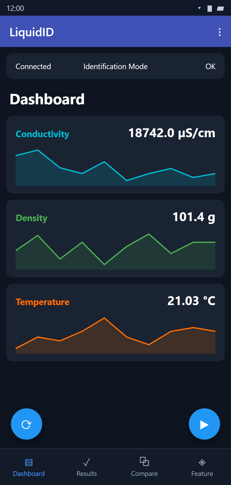
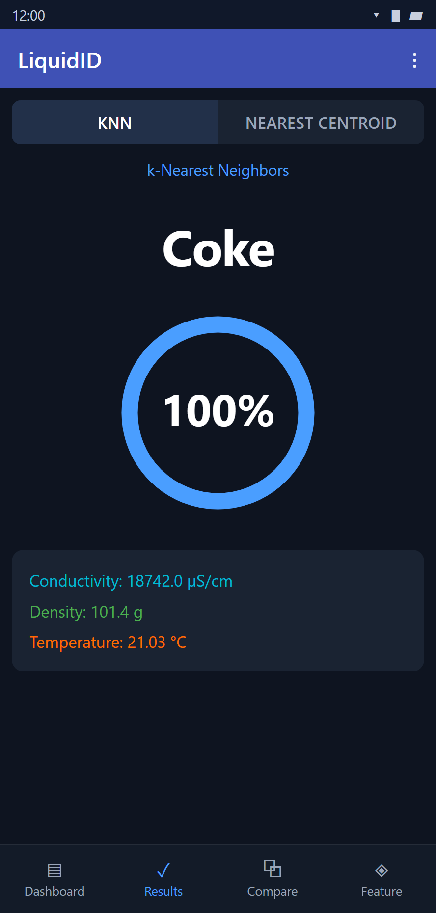
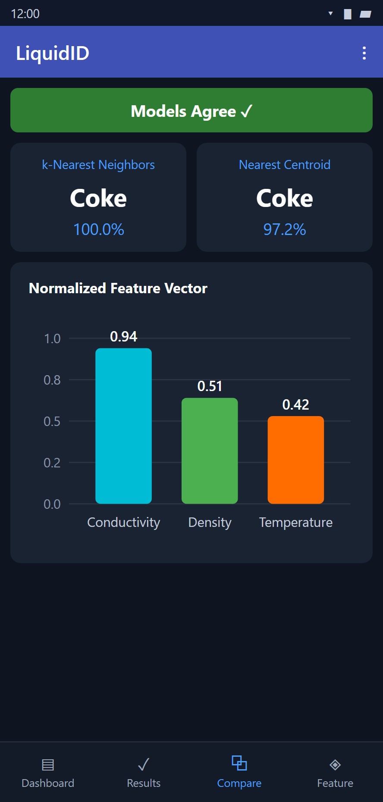
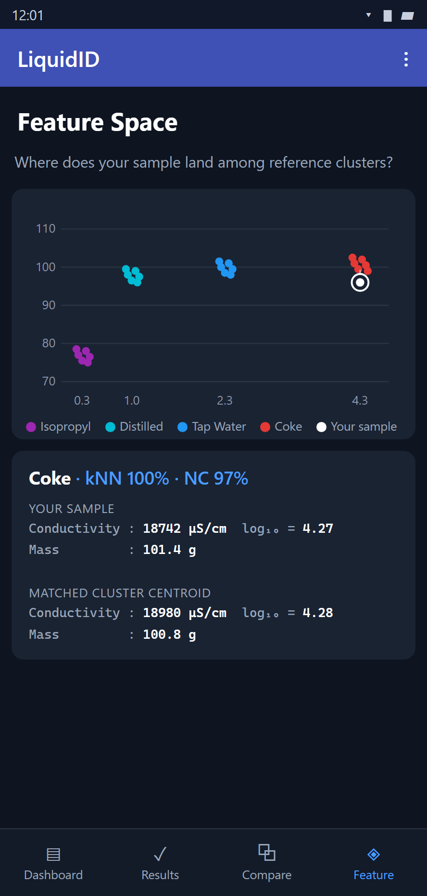

# Multi-Sensor Liquid Identification System

> **UCF Senior Design — Group 17 | Spring/Summer 2026**

An embedded system that identifies liquids in real time. A hand-built probe measures
conductivity, mass and temperature; an **STM32G431KBU6** runs the classifier **on-device** —
no cloud, no phone-side inference — and reports the result on an onboard OLED and over BLE
to a Kotlin companion app.

<p align="center">
  
  
  
  
</p>

<p align="center"><em>Live dashboard · classification result · kNN vs. nearest-centroid · feature space</em></p>

---

## What it does

Press **Start** in the app (or reset the board). The device runs a 5-second measurement
window, takes the median of ~101 conductivity and ~101 load-cell samples plus 3 temperature
reads, runs both classifiers against a model compiled into flash, and shows the predicted
liquid with a confidence score on the OLED and in the app. Liquids that don't resemble
anything trained are reported as **UNKNOWN** rather than forced into the nearest class.

**Six liquids trained:** Coke (flat), distilled water, glycerin, 91% isopropyl alcohol,
saturated salt water, tap water.

### Results

| | |
|---|---|
| Held-out accuracy | **100% (31/31)** — both kNN and nearest centroid |
| Cross-validation | 100% mean, 5-fold, stable across k = 1, 3, 5, 7, 9 |
| Time to result | **~5 s**, Start → classification on screen |
| Dataset | 123 measurements, 6 classes, 75/25 stratified split |
| On-device model | k = 1, 3-feature space, ~90 reference points in flash |

Reproduce the accuracy figures from the data in this repo with the command under
[Retraining](#retraining).

Caveats worth more than the headline number:

- 100% is real but **easy**. The six liquids occupy cleanly separated conductivity bands
  with a wide margin, so the classifier's job is close to thresholding. This is evidence
  the pipeline is correct end to end — not a hard benchmark result.
- Data was collected over a small number of room-temperature sessions. The probe drifts
  between days from DC electrode polarization, so cross-day generalization is weaker than
  these numbers suggest.
- The ~5 s figure is dominated by the sensor-averaging window. The kNN and nearest-centroid
  math over ~90 points is negligible on a 170 MHz Cortex-M4F.

### On "sensor fusion"

All three sensors are sampled, displayed, logged and exported — but **classification
currently runs on conductivity alone**. The post-scaler feature weights are
`[3.0, 0.0, 0.0]`: mass was deliberately zeroed after the load cell was found to drift
±70 g between sessions, which caused false UNKNOWN rejections once the class bands packed
tighter at six classes. Temperature compensates the conductivity reading to 25 °C rather
than feeding the classifier. Restoring mass to the decision is a hardware fix — load-cell
mount and amplifier — not a model change; the training script re-weights and retrains in
one line.

---

## How it works

```
probe ─> STM32G431KBU6 ─> feature vector ─> kNN + nearest centroid ─┬─> SH1106 OLED
                                            (model_params.h, flash) └─> RN4871 BLE ─> Android app
```

The feature pipeline is implemented **twice — identically** — in Python for training and in
C for the device:

1. Conductivity ADC counts → divider ratio `r = adc / (4095 - adc)`, floored at
   `COND_RATIO_FLOOR` so 0-count readings stay finite and cluster tightly. Raw counts are
   used rather than converted mS/cm: the conversion amplifies electrode drift 6–17× near
   its asymptote.
2. `f = [log10(r), mass_g, temp_C]`
3. Standard-scale using the mean/scale exported from training.
4. Multiply by `FEATURE_WEIGHTS`.
5. kNN majority vote over `TRAIN_POINTS`; nearest centroid by `argmin` distance to
   `CENTROIDS`. If the best squared distance exceeds `KNN_REJECT_D2` — half the closest
   inter-class gap — report class 255 = **UNKNOWN**.

Training emits `model_params.h`, a plain C header of `static const float` arrays. There is
no inference runtime on the MCU: the model *is* the header, so the entire classifier is a
few hundred multiply-accumulates.

## Tech stack

**Firmware** — C, STM32CubeIDE, STM32G431KBU6 (Cortex-M4F @ 170 MHz). Bit-banged 1-Wire
DS18B20 temperature, load cell on ADC2, conductivity probe on ADC1, SH1106 OLED over I²C,
RN4871 BLE module on USART2 @ 115200. Line-buffered `START` / `RESET` command interface and
a 3-second dynamic tare on boot.

**ML** — Python 3.12, scikit-learn, NumPy. kNN + nearest centroid, k chosen by
cross-validation, `StandardScaler`, log-transformed conductivity, unknown-rejection radius
derived from the minimum inter-class gap. Emits both a `.joblib` bundle and the C header.

**Android** — Kotlin, MVVM with StateFlow, BLE serial transport, MPAndroidChart. Four
screens: live dashboard, classification result, kNN-vs-nearest-centroid comparison, and a
2-D feature-space plot showing the live reading against the trained clusters. CSV/JSON
session export feeds straight back into the training script.

## Repository layout

```
firmware/   STM32CubeIDE project — Core/Src/main.c holds drivers + classifier,
            Core/Inc/model_params.h is the generated model
android/    Kotlin companion app (Gradle)
ml/         training pipeline, calibration helpers, banked sensor CSVs
docs/       screenshots
```

## Getting started

**Firmware** — open `firmware/` in STM32CubeIDE (≥ 1.14), build, flash over ST-Link.
`Core/Inc/model_params.h` must be regenerated and reflashed whenever the model changes.

**App** — open `android/` in Android Studio, or:

```bash
cd android && ./gradlew installDebug
```

### Retraining

Export a session from the app, pull the CSV into `ml/data/`, then:

```bash
cd ml
python train_model.py coke=data/coke_room.csv distilled=data/distilledwater_room.csv glycerin=data/glycerin_room.csv isopropyl=data/isopropyl_room.csv salt_water=data/saltwater_room.csv tap_water=data/tapwater_room.csv
```

This writes `liquid_model.joblib` and `model_params.h`. Copy the header into
`firmware/Core/Inc/` and reflash. Class indices are assigned **alphabetically**, so the
app's `CLASS_NAMES` list must stay in that same order as the header.

## Hardware

| Component | Part | Purpose |
|---|---|---|
| Microcontroller | STM32G431KBU6 | ADC, classification, OLED + BLE drive |
| Conductivity probe | Two-electrode cell | Conductivity via resistive divider on ADC1 |
| Load cell | Strain gauge + amplifier on ADC2 | Mass |
| Temperature | DS18B20 | 1-Wire digital temperature |
| Display | SH1106 128×64 OLED | On-device result readout |
| Wireless | RN4871 | BLE serial link to the app |

## Known limitations

- The load cell drifts between sessions and is excluded from the classification decision.
- The conductivity probe is accurate to roughly 2 mS/cm; above that the response compresses
  and consecutive readings can differ by ~9% from DC electrode polarization. Coke sits near
  that ceiling — which is why coffee was tested and **rejected** as a class: it lands on top
  of Coke.
- Glycerin has only 18 training samples; the target is 30+.
- One measurement per `START`; there is no continuous streaming mode.

## Team

| Name | Role |
|---|---|
| Johan Johnson | Computer Engineering |
| Frederick Hornberger | Computer Engineering |
| John McGuire | Computer Engineering |

**Advisors:** Dr. Reza Abdolvand · Dr. Saleem Sahawneh · Dr. Mike Maddox

## License

Developed as part of UCF Senior Design (EEL 4914 / EEL 4915). All rights reserved by the
authors.
