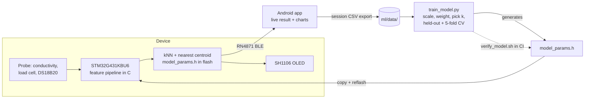

# Multi-Sensor Liquid Identification System

> **UCF Senior Design — Group 17 | Spring/Summer 2026**

[](https://github.com/JohanJ0318/multi-sensor-liquid-id/actions/workflows/verify-model.yml)

An embedded system that identifies liquids in real time. A hand-built probe measures
conductivity, mass and temperature; an **STM32G431KBU6** runs the classifier **on-device** —
no cloud, no phone-side inference — and reports the result on an onboard OLED and over BLE
to a Kotlin companion app.

<p align="center">
  
  
  
  
</p>

<p align="center"><em>Live dashboard · classification result · kNN vs. nearest-centroid · feature space</em></p>

---

## What it does

Press **Start** in the app (or reset the board). The device runs a 5-second measurement
window, takes the median of ~101 conductivity and ~101 load-cell samples plus 3 temperature
reads, runs both classifiers against a model compiled into flash, and shows the predicted
liquid with a confidence score on the OLED and in the app. Liquids that don't resemble
anything trained are reported as **UNKNOWN** rather than forced into the nearest class.

**Six liquids trained:** Coke (flat), distilled water, glycerin, 91% isopropyl alcohol,
saturated salt water, tap water.

### Results

| | |
|---|---|
| Held-out accuracy | **100% (31/31)** — both kNN and nearest centroid |
| Cross-validation | 100% mean, 5-fold, stable across k = 1, 3, 5, 7, 9 |
| Time to result | **~5 s**, Start → classification on screen |
| Dataset | 123 measurements, 6 classes, 75/25 stratified split |
| On-device model | k = 1, 3-feature space, 92 reference points in flash |

Reproduce the accuracy figures from the data in this repo with the command under
[Retraining](#retraining).

Caveats worth more than the headline number:

- 100% is real but **easy**. The six liquids occupy cleanly separated conductivity bands
  with a wide margin, so the classifier's job is close to thresholding. This is evidence
  the pipeline is correct end to end — not a hard benchmark result.
- Data was collected over a small number of room-temperature sessions. The probe drifts
  between days from DC electrode polarization, so cross-day generalization is weaker than
  these numbers suggest.
- The ~5 s figure is dominated by the sensor-averaging window. The kNN and nearest-centroid
  math over 92 points is negligible on a 170 MHz Cortex-M4F.

### What actually drives the decision

Post-scaler feature weights are `[3.0, 0.25, 0.0]` — conductivity, mass, temperature.

**Conductivity** carries the classification; it separates all six liquids on its own at
100% cross-validated accuracy.

**Mass** contributes real density information — glycerin reads ~124 g and isopropyl ~80 g
against the ~100 g water group. Its weight is deliberately small because the load cell
drifts up to ±70 g between sessions, and the weight was chosen by measuring how much drift
each setting survives:

| mass weight | accuracy @ ±40 g | accuracy @ ±70 g |
|---|---|---|
| 0.25 | 100% | **100%** |
| 0.50 | 100% | 83.9% |
| 1.00 | 80.6% / 64.5% | 64.5% / 48.4% |

0.25 is the largest weight that survives the full observed drift intact, and it widens the
unknown-rejection radius slightly (0.286 → 0.290).

**Temperature is weighted zero on purpose.** Every liquid was measured at room temperature
in a single session each, so within-class spread is 0.02–0.15 °C while between-class spread
is ~1.5 °C. Ambient temperature is therefore an excellent *session* fingerprint — it
classifies at 72% by itself — while carrying no information about liquid identity, and the
firmware already compensates conductivity to 25 °C. Weighting it looks free in
cross-validation and then fails in a warmer room: at `[3, 1, 1]`, a +2 °C ambient shift
drops accuracy to 32%. Giving temperature a real vote requires collecting each liquid
across a genuine temperature range, not reweighting the existing data.

---

## How it works

The whole loop, from collecting data to running the model on the device and back:



At run time the path is just the top row:

```
probe ─> STM32G431KBU6 ─> feature vector ─> kNN + nearest centroid ─┬─> SH1106 OLED
                                            (model_params.h, flash) └─> RN4871 BLE ─> Android app
```

The feature pipeline is implemented **twice — identically** — in Python for training and in
C for the device:

1. Conductivity ADC counts → divider ratio `r = adc / (4095 - adc)`, floored at
   `COND_RATIO_FLOOR` so 0-count readings stay finite and cluster tightly. Raw counts are
   used rather than converted mS/cm: the conversion amplifies electrode drift 6–17× near
   its asymptote.
2. `f = [log10(r), mass_g, temp_C]`
3. Standard-scale using the mean/scale exported from training.
4. Multiply by `FEATURE_WEIGHTS`.
5. kNN majority vote over `TRAIN_POINTS`; nearest centroid by `argmin` distance to
   `CENTROIDS`. If the best squared distance exceeds `KNN_REJECT_D2` — half the closest
   inter-class gap — report class 255 = **UNKNOWN**.

Training emits `model_params.h`, a plain C header of `static const float` arrays. There is
no inference runtime on the MCU: the model *is* the header, so the entire classifier is a
few hundred multiply-accumulates.

## Tech stack

**Firmware** — C, STM32CubeIDE, STM32G431KBU6 (Cortex-M4F @ 170 MHz). Bit-banged 1-Wire
DS18B20 temperature, load cell on ADC2, conductivity probe on ADC1, SH1106 OLED over I²C,
RN4871 BLE module on USART2 @ 115200. Line-buffered `START` / `RESET` command interface and
a 3-second dynamic tare on boot.

**ML** — Python 3.12, scikit-learn, NumPy. kNN + nearest centroid, k chosen by
cross-validation, `StandardScaler`, log-transformed conductivity, unknown-rejection radius
derived from the minimum inter-class gap. Emits both a `.joblib` bundle and the C header.

**Android** — Kotlin, MVVM with StateFlow, BLE serial transport, MPAndroidChart. Four
screens: live dashboard, classification result, kNN-vs-nearest-centroid comparison, and a
2-D feature-space plot showing the live reading against the trained clusters. CSV/JSON
session export feeds straight back into the training script.

## Repository layout

```
firmware/   STM32CubeIDE project — Core/Src/main.c holds drivers + classifier,
            Core/Inc/model_params.h is the generated model
android/    Kotlin companion app (Gradle)
ml/         training pipeline, calibration helpers, banked sensor CSVs
docs/       screenshots
```

## Getting started

**Firmware** — open `firmware/` in STM32CubeIDE (≥ 1.14), build, flash over ST-Link.
`Core/Inc/model_params.h` must be regenerated and reflashed whenever the model changes.

**App** — open `android/` in Android Studio, or:

```bash
cd android && ./gradlew installDebug
```

### Retraining

Export a session from the app, pull the CSV into `ml/data/`, then:

```bash
cd ml
pip install -r requirements.txt
python train_model.py coke=data/coke_room.csv distilled=data/distilledwater_room.csv glycerin=data/glycerin_room.csv isopropyl=data/isopropyl_room.csv salt_water=data/saltwater_room.csv tap_water=data/tapwater_room.csv
```

This writes `liquid_model.joblib` and `model_params.h`. Copy the header into
`firmware/Core/Inc/` and reflash. Class indices are assigned **alphabetically**, so the
app's `CLASS_NAMES` list must stay in that same order as the header.

To confirm the committed header still matches the data and training code, run
`bash ml/verify_model.sh`. CI runs the same check on every change under `ml/`.

## Hardware

| Component | Part | Purpose |
|---|---|---|
| Microcontroller | STM32G431KBU6 | ADC, classification, OLED + BLE drive |
| Conductivity probe | Two-electrode cell | Conductivity via resistive divider on ADC1 |
| Load cell | Strain gauge + amplifier on ADC2 | Mass |
| Temperature | DS18B20 | 1-Wire digital temperature |
| Display | SH1106 128×64 OLED | On-device result readout |
| Wireless | RN4871 | BLE serial link to the app |

## What broke, and how we found it

Most of the design decisions above came from something going wrong first.

| Problem | How it showed up | What we changed |
|---|---|---|
| Converting conductivity to mS/cm made drift worse | Readings from the same liquid spread far more after conversion than in raw ADC counts; near the conversion's asymptote, electrode drift was amplified 6–17× | Classify on `log10` of the raw divider ratio instead of mS/cm |
| 0-count conductivity readings | Low-conductivity liquids sometimes read 0 counts, which sends the log feature to −∞ | Floor the divider ratio at `COND_RATIO_FLOOR` so those readings stay finite and cluster tightly |
| Temperature looked useful but wasn't | Temperature alone classified at 72%, which was suspicious; each liquid had been measured in a single room-temperature session, so it was fingerprinting the session, not the liquid. Simulating a +2 °C room at weights `[3, 1, 1]` dropped accuracy to 32% | Weight temperature at 0 and rely on firmware compensation of conductivity to 25 °C |
| Load cell drift between sessions | Mass for the same liquid moved by up to ±70 g between days | Swept the mass weight against simulated drift (table above) and kept 0.25, the largest weight that survives the full observed drift |
| Coffee landed on top of Coke | Both sit near the probe's ~2 mS/cm ceiling, where DC electrode polarization makes consecutive readings differ by ~9% | Dropped coffee as a class rather than ship a classifier that guesses |
| The repo and the flashed device disagreed | A second copy of the generated header in `ml/` let the committed model drift from what was actually on the board | Made `firmware/Core/Inc/model_params.h` the single source of truth, ignored the `ml/` copy in Git, and added `ml/verify_model.sh` plus a CI check |

## Known limitations

- The load cell drifts between sessions, so mass gets only a small weight (0.25) in the
  decision; conductivity does most of the work.
- The conductivity probe is accurate to roughly 2 mS/cm; above that the response compresses
  and consecutive readings can differ by ~9% from DC electrode polarization. Coke sits near
  that ceiling — which is why coffee was tested and **rejected** as a class: it lands on top
  of Coke.
- Glycerin has only 18 training samples; the target is 30+.
- One measurement per `START`; there is no continuous streaming mode.

## Team

Johan Johnson · John McGuire · Frederick Hornberger

## License

Developed as part of UCF Senior Design (EEL 4914 / EEL 4915). All rights reserved by the
authors.
